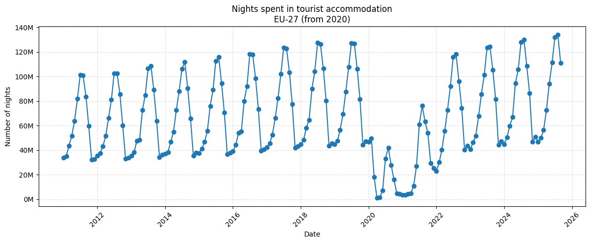
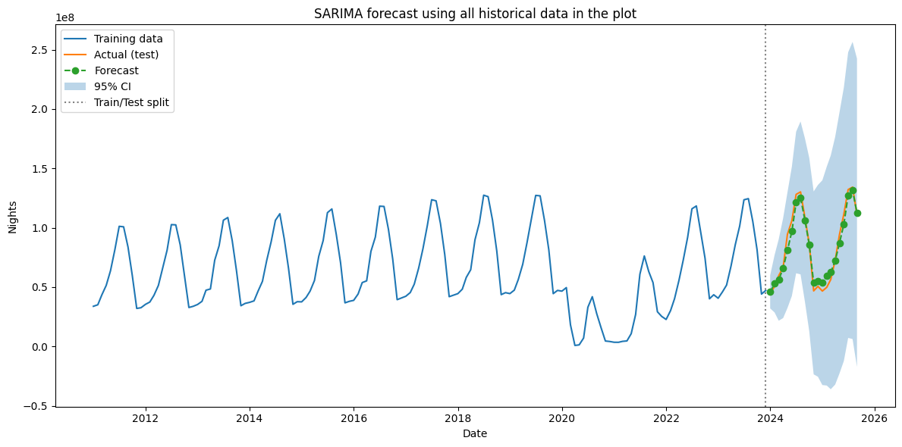

# Forecasting EU-27 Tourist Nights

A time-series analysis of monthly nights spent at tourist accommodation establishments in the EU-27. The project explores seasonal travel patterns and the disruption associated with COVID-19, then fits a seasonal ARIMA model to investigate forecasting tourism demand for operational planning.



## My work

I used Python to clean and reshape the tourism series, explore seasonality, test stationarity, compare SARIMA specifications, inspect residuals, and plot a holdout forecast. The [analysis notebook](tourism-forecast-analysis.ipynb) contains the code and saved outputs; the [project report](tourism-forecast-report.pdf) describes the approach and findings. The [presentation](Forecasting%20EU-27%20Tourist%20Nights.pptx) provides a visual overview.

## Approach and results

- The notebook's saved output contains 177 monthly observations from January 2011 through September 2025. It shows recurring summer peaks and a sharp decline during the pandemic.
- After first and seasonal differencing, the notebook compares SARIMA models using information criteria. Its saved output selects **SARIMA(0,1,2) × (0,1,2)₁₂** by BIC; the displayed BIC is approximately 4699.56.
- The notebook fits the selected specification to data through December 2023 and plots predictions for the 21 observations from January 2024 through September 2025. The report cites a Ljung–Box p-value of 0.64; this is a diagnostic result, not a measure of forecast accuracy.



The report and notebook differ on the data end date and holdout length, and the notebook does not calculate the MAE, RMSE, or MAPE mentioned in the report or contain code for a separate 12-month future forecast. Model selection also uses the full series before the holdout fit, so the holdout is not independent of model selection. These results should be treated as exploratory until the analysis is rerun and reconciled.

## Tools

Python, pandas, NumPy, Matplotlib, statsmodels, Jupyter Notebook, and an Excel reader such as openpyxl. The data is described in the notebook as a Eurostat extract.

## Run the notebook

The included `data.xlsx` contains the EU-27 aggregate from September 2019 through September 2025 (73 monthly observations). The notebook’s saved outputs use 177 observations beginning in January 2011, so this spreadsheet cannot reproduce those saved results. Obtain the original full-period Eurostat extract and place it beside the notebook as `data.xlsx` to reproduce the original analysis. The code assumes the first remaining data row is the EU-27 aggregate; check that assumption against any replacement file.

With Python installed, a typical setup is:

```bash
python -m venv .venv
source .venv/bin/activate  # Windows: .venv\Scripts\activate
python -m pip install jupyter pandas numpy matplotlib statsmodels openpyxl
jupyter notebook tourism-forecast-analysis.ipynb
```

Run the cells in order. The first cell also installs statsmodels; the grid search fits up to 81 combinations and may take time. Exact dependency versions are not recorded. These instructions have not been tested end-to-end with the full-period input file.

## Files

- [Analysis notebook](tourism-forecast-analysis.ipynb) — code, figures, and saved outputs.
- [Project report](tourism-forecast-report.pdf) — written summary of the analysis.
- [Presentation](Forecasting%20EU-27%20Tourist%20Nights.pptx) — presentation slides.
- `images/` — two figures extracted from the notebook for this README.
